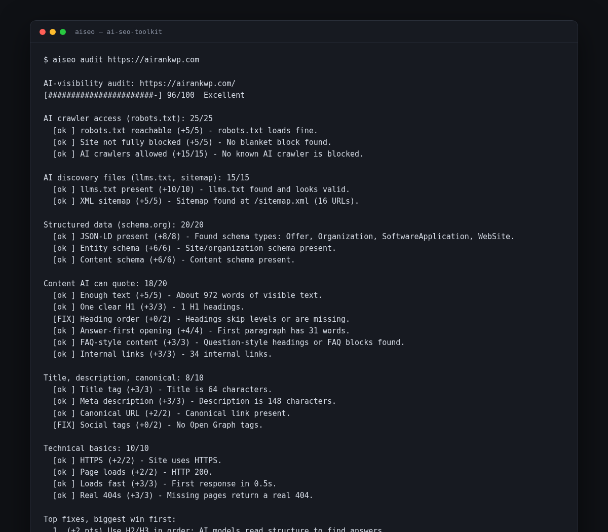
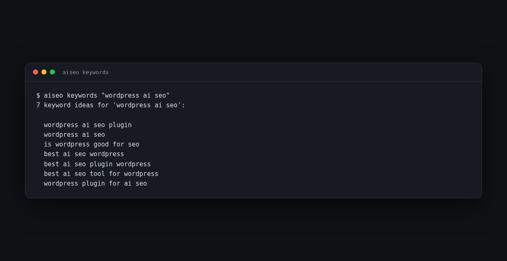

# AI SEO Toolkit

**Can ChatGPT, Perplexity, Gemini and Claude find your website — and would they cite it?**

One free command checks any website and tells you what to fix. Plus free keyword ideas and your Google Search Console data, right in your terminal. No account, no paid API keys.



Made by the team behind [AIRankWP](https://airankwp.com) — the WordPress plugin that finds these problems **and fixes them for you** inside WordPress. This toolkit is the free, do-it-yourself version.

---

## What you get

| Command | What it does |
|---|---|
| `aiseo audit <website>` | Scores any site 0–100 on AI-search visibility and lists the exact fixes, biggest win first |
| `aiseo keywords <topic>` | Free keyword ideas real people type into Google |
| `aiseo gsc ...` | Your own Google Search Console data: top queries, pages, sitemaps, indexing |

---

## Install (2 minutes, anyone can do it)

**Step 1 — Install Python** (skip if you have it):

- Windows: [python.org/downloads](https://www.python.org/downloads/) → run the installer → **tick "Add python.exe to PATH"** → Install.
- Mac: open Terminal and type `python3 --version`. If it's missing, install from [python.org/downloads](https://www.python.org/downloads/).

**Step 2 — Install the toolkit.** Open Terminal (Mac) or Command Prompt (Windows) and paste:

```bash
pip install git+https://github.com/devanasolver/ai-seo-toolkit
```

On a Mac, if that says "command not found", use `pip3` instead of `pip`.

**Step 3 — Run your first audit:**

```bash
aiseo audit https://yourwebsite.com
```

That's it. You'll get a score out of 100 and a to-do list.

---

## Reading your audit

```
AI-visibility audit: https://yourwebsite.com
[#######################-] 96/100  Excellent
```

The audit checks 6 things that decide whether AI assistants can crawl, understand and cite you:

1. **AI crawler access** — does your `robots.txt` welcome GPTBot, ClaudeBot, PerplexityBot and friends?
2. **AI discovery files** — do you have `llms.txt` and an XML sitemap?
3. **Structured data** — schema.org markup that tells AI who you are.
4. **Content AI can quote** — clear headings, answer-first paragraphs, real questions with short answers.
5. **Title, description, canonical** — the basics done right.
6. **Technical basics** — HTTPS, fast loading, real 404 pages.

Under the score you get **Top fixes, biggest win first**. Start at number 1.

Machine-readable output for scripts and CI:

```bash
aiseo audit https://yourwebsite.com --json
```

---

## Free keyword ideas

Find out what people actually type before you write:

```bash
aiseo keywords "ai seo"
```



You get dozens of real searches — question-style ("how ai seo works") and alphabet expansion ("ai seo tools"). Use them as blog topics and headings. JSON with `--json`.

---

## Your Search Console data (optional, free)

See which Google searches already bring you visitors — no paid SEO tool needed.

**One-time setup (5 minutes):**

1. Open [console.cloud.google.com/apis/credentials](https://console.cloud.google.com/apis/credentials) (free Google account).
2. Create a project, enable the **Google Search Console API**.
3. Create an **OAuth client** (type: *Desktop app*) and download the JSON file.
4. Save it as `~/.config/aiseo/client_secrets.json`.
5. Install the extra packages: `pip install "ai-seo-toolkit[gsc]"`
6. Sign in once: `aiseo gsc auth` — a browser opens, you click your account, done.

**Then:**

```bash
aiseo gsc properties                                    # your sites
aiseo gsc analytics https://yoursite.com --days 28      # top queries
aiseo gsc analytics https://yoursite.com --dimensions page
aiseo gsc sitemaps https://yoursite.com                 # sitemap errors
aiseo gsc inspect https://yoursite.com https://yoursite.com/blog/post  # indexed?
```

Your data goes straight from Google to your computer. Nothing is sent anywhere else.

---

## What this toolkit checks — and what it doesn't do

This toolkit **finds and explains** problems. It does not change your site.

If your site runs on WordPress, [AIRankWP](https://airankwp.com) does the next step: it scans like this toolkit, then **fixes the problems for you** — safe one-click fixes with undo, AI-bot robots.txt rules, llms.txt, schema, content queue, and an AI-traffic dashboard. Free plan available.

---

## For AI agents

This repo ships an [AGENTS.md](AGENTS.md) so coding assistants (Claude Code, Cursor, Codex, Antigravity) can use the toolkit correctly: run audits, read JSON output, and interpret scores.

## License and credits

MIT — use it anywhere, see [LICENSE](LICENSE).

This project stands on good ideas from the open-source community; see [NOTICE](NOTICE) for credits to geo-optimizer-skill, mcp-gsc and OpenSEO. Code here is original.

## Support

If you find this project useful, [buy me a coffee](https://buymeacoffee.com/isaac49).
